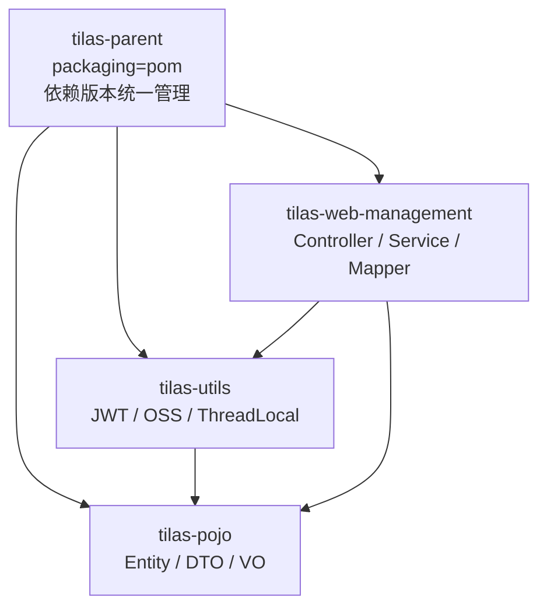

# tilas 智能学习辅助系统

> 基于 Spring Boot 4 + MyBatis + JWT + AOP 的企业级后台管理系统，采用标准多模块 Maven 架构，开箱即用的 Docker Compose 一键部署。

[](https://openjdk.org/)
[](https://spring.io/projects/spring-boot)
[](https://mybatis.org/)
[](https://www.mysql.com/)
[](https://www.docker.com/)

---

## 一、项目简介

tilas 是一个面向教育培训机构的内部管理后台，覆盖 **部门管理、员工管理、数据统计报表、文件上传** 四大业务域，并提供完整的 **JWT 登录认证** 与 **AOP 操作日志审计** 能力。

项目已从单体结构重构为标准的多模块 Maven 工程，配套 `Dockerfile`、`docker-compose.yml` 与数据库初始化脚本，可直接 `git clone` 后一键启动。

### 核心特性

| 特性 | 说明 |
| --- | --- |
| 统一响应封装 | 所有接口统一返回 `Result{code, msg, data}` |
| 三层架构 | 严格遵守 Controller → Service → Mapper，面向接口编程 |
| 事务一致性 | 多表操作统一使用 `@Transactional(rollbackFor = Exception.class)` |
| 登录认证 | JWT 无状态令牌 + HandlerInterceptor 全局拦截，放行登录接口 |
| 操作审计 | 自定义 `@Log` 注解 + AOP 环绕通知，异步留痕至 `operate_log` |
| 敏感信息外置 | 数据库密码、JWT 密钥、OSS 凭证全部由配置文件 / 环境变量注入 |
| 容器化 | 多阶段 Dockerfile + Docker Compose 编排 MySQL 与后端服务 |

---

## 二、技术选型

| 分类 | 技术 | 版本 |
| --- | --- | --- |
| 基础框架 | Spring Boot | 4.0.8 |
| 运行环境 | OpenJDK | 21 |
| 持久层 | MyBatis Spring Boot Starter | 4.0.1 |
| 分页插件 | PageHelper | 1.4.7 |
| 数据库 | MySQL | 8.0 |
| 连接池 | HikariCP | Spring Boot 内置 |
| 认证 | JJWT | 0.9.1 |
| 切面 | Spring AOP (AspectJ) | Spring Boot 内置 |
| 对象存储 | 阿里云 OSS SDK | 3.17.4 |
| 序列化 | Jackson | 3.1.5（Spring Boot 4 默认） |
| 构建工具 | Maven | 3.9+ |
| 容器化 | Docker / Docker Compose | — |

---

## 三、系统架构

### 3.1 请求处理链路

```mermaid
flowchart LR
    A[前端 / 客户端] -->|HTTP + token 请求头| B[Tomcat]
    B --> C{TokenInterceptor<br/>登录校验}
    C -->|放行 /login| F[Controller]
    C -->|token 合法<br/>写入 CurrentHolder| F
    C -->|token 缺失或失效| X[401 Result NOT_LOGIN]
    F -->|标注 @Log| G[OperationLogAspect<br/>环绕通知]
    G --> F
    F --> H[Service<br/>@Transactional]
    H --> I[Mapper]
    I --> J[(MySQL)]
    G -.->|记录操作日志| J
    F --> K[GlobalExceptionHandler]
```

### 3.2 模块依赖关系



### 3.3 模块职责

| 模块 | 职责 | 关键内容 |
| --- | --- | --- |
| `tilas-parent` | 父工程，`packaging=pom` | `<dependencyManagement>` 统一版本、Lombok 注解处理器配置 |
| `tilas-pojo` | 数据模型层 | `Dept`、`Emp`、`EmpExpr`、`OperateLog`、`Result`、`PageResult`、`EmpQueryParam`、`LoginInfo`、`JobOption`、`AliyunOSSProperties` |
| `tilas-utils` | 公共工具层 | `JwtUtils`、`AliyunOSSOperator`、`CurrentHolder` |
| `tilas-web-management` | 核心业务层 | 4 个 Controller、3 个 Service、4 个 Mapper、拦截器、切面、全局异常处理、启动类 |

---

## 四、目录结构

```
tilas/
├── pom.xml                              # 父工程 tilas-parent
├── Dockerfile                           # 后端多阶段构建镜像
├── docker-compose.yml                   # MySQL + 后端 一键编排
├── .dockerignore
├── .gitignore
├── README.md
├── sql/
│   └── schema.sql                       # 建表语句 + 初始化测试数据
├── docker/
│   └── nginx/
│       └── nginx.conf                   # 【可选】前端托管 + 反向代理模板
├── tilas-pojo/
│   ├── pom.xml
│   └── src/main/java/com/itheima/pojo/
├── tilas-utils/
│   ├── pom.xml
│   └── src/main/java/com/itheima/util/
└── tilas-web-management/
    ├── pom.xml
    └── src/main/
        ├── java/com/itheima/
        │   ├── TilasWebManagementApplication.java
        │   ├── anno/Log.java                     # 自定义操作日志注解
        │   ├── aop/OperationLogAspect.java       # 操作日志切面
        │   ├── config/WebConfig.java             # 拦截器 + 跨域注册
        │   ├── controller/                       # Dept / Emp / Login / Report / Upload
        │   ├── exception/GlobalExceptionHandler.java
        │   ├── interceptor/TokenInterceptor.java # 登录校验拦截器
        │   ├── mapper/                           # 4 个 Mapper 接口
        │   └── service/                          # Service 接口 + impl 实现
        └── resources/
            ├── application.yml
            ├── logback.xml
            └── com/itheima/mapper/               # MyBatis XML 映射文件
```

---

## 五、快速开始

### 5.1 环境要求

| 依赖 | 版本 |
| --- | --- |
| JDK | 21+ |
| Maven | 3.9+ |
| MySQL | 8.0+ |
| Docker（可选） | 20.10+ / Compose v2 |

### 5.2 方式一：Docker Compose 一键启动（推荐）

```bash
# 1. 克隆项目
git clone <your-repo-url>.git
cd tilas

# 2. 构建并启动（首次会自动构建镜像、初始化数据库）
docker compose up -d --build

# 3. 查看服务状态与日志
docker compose ps
docker compose logs -f tilas-backend

# 4. 停止（保留数据） / 清空数据
docker compose down
docker compose down -v
```

启动完成后：

| 服务 | 地址 |
| --- | --- |
| 后端 API | http://localhost:8080 |
| MySQL | localhost:3306（root / 123456） |

> **可选**：需要同时托管前端时，将前端 `dist` 产物放入 `docker/nginx/dist`，取消 `docker-compose.yml` 中 `nginx` 服务的注释后重新执行 `docker compose up -d --build`。

### 5.3 方式二：本地运行

```bash
# 1. 初始化数据库（会创建 tilas 库、4 张表及初始测试数据）
mysql -uroot -p < sql/schema.sql

# 2. 按需调整数据库连接（默认 root/123456，可跳过）
#    修改 tilas-web-management/src/main/resources/application.yml

# 3. 编译打包（在工程根目录执行）
mvn clean package -DskipTests

# 4. 启动应用
java -jar tilas-web-management/target/tilas-web-management.jar
```

也可以直接在 IDE 中运行 `TilasWebManagementApplication`。

### 5.4 测试账号

| 用户名 | 密码 | 说明 |
| --- | --- | --- |
| `admin` | `123456` | 教研主管（由 `sql/schema.sql` 初始化） |
| `zhangsan` | `123456` | 讲师 |
| `lisi` | `123456` | 讲师 |

### 5.5 接口自测

```bash
# 1. 登录获取 token
curl -X POST http://localhost:8080/login \
     -H "Content-Type: application/json" \
     -d '{"username":"admin","password":"123456"}'

# 2. 携带 token 访问业务接口
curl http://localhost:8080/depts -H "token: <上一步返回的 token>"

# 3. 不带 token 访问（预期返回 401 + NOT_LOGIN）
curl -i http://localhost:8080/depts
```

---

## 六、接口文档

### 6.1 统一响应结构

```json
{
  "code": 1,
  "msg": "success",
  "data": {}
}
```

| 字段 | 说明 |
| --- | --- |
| `code` | `1` 成功，`0` 失败 |
| `msg` | 提示信息，未登录时为 `NOT_LOGIN` |
| `data` | 业务数据 |

### 6.2 认证约定

- 除 `/login` 外的所有接口均需在请求头中携带 `token`
- 校验失败统一返回 **HTTP 401** 与 `{"code":0,"msg":"NOT_LOGIN","data":null}`
- 前端拦截 `msg === "NOT_LOGIN"` 后重定向至登录页

### 6.3 接口清单

#### 登录认证

| 方法 | 路径 | 说明 |
| --- | --- | --- |
| POST | `/login` | 员工登录，返回 `{id, username, name, token}` |

#### 部门管理

| 方法 | 路径 | 说明 |
| --- | --- | --- |
| GET | `/depts` | 查询全部部门 |
| GET | `/depts/{id}` | 根据 ID 查询部门 |
| POST | `/depts` | 新增部门 |
| PUT | `/depts` | 修改部门 |
| DELETE | `/depts?id=1` | 删除部门 |

#### 员工管理

| 方法 | 路径 | 说明 |
| --- | --- | --- |
| GET | `/emps?page=1&pageSize=10&name=&gender=&begin=&end=` | 分页查询（支持姓名模糊、性别、入职日期区间） |
| GET | `/emps/{id}` | 查询详情（含工作经历列表） |
| POST | `/emps` | 新增员工（含工作经历） |
| PUT | `/emps` | 修改员工（工作经历全量覆盖） |
| DELETE | `/emps?ids=1,2,3` | 批量删除员工 |

#### 数据统计

| 方法 | 路径 | 说明 |
| --- | --- | --- |
| GET | `/report/empJobData` | 各职位员工人数统计 |
| GET | `/report/empGenderData` | 员工性别分布统计 |

#### 文件上传

| 方法 | 路径 | 说明 |
| --- | --- | --- |
| POST | `/upload` | 上传文件至阿里云 OSS，返回可访问 URL |

---

## 七、数据库设计

| 表名 | 说明 | 关键字段 |
| --- | --- | --- |
| `dept` | 部门表 | `name`（唯一） |
| `emp` | 员工表 | `username`、`phone`（唯一），`password` 默认 `123456` |
| `emp_expr` | 工作经历表 | `begin`、`end` 为 MySQL 关键字，需反引号包裹 |
| `operate_log` | 操作日志表 | 操作人、时间、类名、方法名、入参、返回值、耗时 |

完整建表语句与初始化数据见 [`sql/schema.sql`](sql/schema.sql)。

---

## 八、配置说明

`application.yml` 中所有可变配置均支持环境变量覆盖，便于容器化部署：

| 环境变量 | 默认值 | 说明 |
| --- | --- | --- |
| `SERVER_PORT` | `8080` | 服务端口 |
| `DB_HOST` / `DB_PORT` | `localhost` / `3306` | 数据库地址 |
| `DB_NAME` | `tilas` | 数据库名 |
| `DB_USERNAME` / `DB_PASSWORD` | `root` / `123456` | 数据库账号密码 |
| `JWT_SIGN_KEY` | 内置开发密钥 | **Base64 编码**的 JWT 签名密钥 |
| `JWT_EXPIRE` | `43200000` | 令牌有效期（毫秒，默认 12 小时） |
| `OSS_ENDPOINT` / `OSS_BUCKET` / `OSS_REGION` | — | 阿里云 OSS 配置 |
| `OSS_ACCESS_KEY_ID` / `OSS_ACCESS_KEY_SECRET` | 空 | OSS 访问凭证，留空时读取同名环境变量 |
| `JAVA_OPTS` | `-Xms256m -Xmx512m` | JVM 启动参数 |
| `LOG_HOME` | `logs` | 日志文件目录 |

### 操作日志实现说明

`@Log` 注解标注在 Controller 的增删改方法上，由 `OperationLogAspect` 以**环绕通知**方式拦截，在 `finally` 块中落库，因此目标方法抛出异常时同样留痕：

```java
@Log
@DeleteMapping("/depts")
public Result delete(@RequestParam("id") Integer deptId) { ... }
```

记录字段包括：操作人 ID（从 JWT 经 `CurrentHolder` 传递）、操作时间、类名、方法名、入参（JSON）、返回值（JSON）、执行耗时。
日志写入失败会被降级为 WARN 日志，**不会影响主业务流程**。

---

## 九、安全说明

| 项目 | 现状 | 生产建议 |
| --- | --- | --- |
| 数据库密码 / JWT 密钥 | 通过环境变量注入，代码中无硬编码 | 使用密钥管理服务（KMS / Vault） |
| JWT 签名密钥 | 提供开发默认值 | **务必**通过 `JWT_SIGN_KEY` 覆盖为随机值 |
| 员工密码 | 明文存储（与教学示例一致） | 建议改用 BCrypt 加盐哈希 |
| OSS 凭证 | 优先环境变量，避免落入配置文件 | 推荐使用 RAM 子账号或实例角色 |
| 容器运行身份 | 非 root 用户（uid 1001） | 结合只读根文件系统与资源限制 |
| 密码字段外泄 | 列表与详情查询已显式排除 `password` | — |

---

## 十、常见问题

**Q1：`docker compose up` 后后端报数据库连接失败？**
MySQL 首次启动初始化需要 30~60 秒，`docker-compose.yml` 已通过 `healthcheck` + `depends_on.condition` 保证后端在 MySQL 健康后再启动。若仍失败，执行 `docker compose logs mysql` 排查。

**Q2：修改了 `sql/schema.sql`，但容器里的表没变化？**
`docker-entrypoint-initdb.d` 中的脚本**仅在数据卷为空时执行一次**。需执行 `docker compose down -v` 清空数据卷后重新启动。

**Q3：文件上传报错？**
`/upload` 依赖阿里云 OSS，需正确配置 `OSS_ACCESS_KEY_ID` / `OSS_ACCESS_KEY_SECRET` 及 Bucket 权限。未配置时其余接口不受影响。

**Q4：接口返回 `{"code":0,"msg":"NOT_LOGIN"}`？**
请求头缺少 `token` 或令牌已过期，请重新调用 `/login` 获取。

**Q5：`emp_expr` 表操作报 SQL 语法错误？**
`begin` / `end` 是 MySQL 关键字，SQL 中必须使用反引号包裹（项目内已处理）。

---

## 十一、开发约定

- 所有接口返回统一包装类 `Result`
- 严格遵守 Controller → Service → Mapper 三层架构，面向接口编程
- 涉及多表操作必须使用 `@Transactional(rollbackFor = Exception.class)`
- 敏感信息一律通过 `application.yml` 或环境变量注入，禁止硬编码
- 增删改接口统一标注 `@Log` 以纳入操作审计

---

## 十二、声明

本项目为教学实践项目，仅供学习与技术交流使用。
